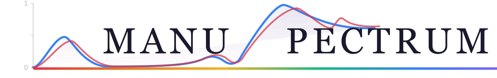
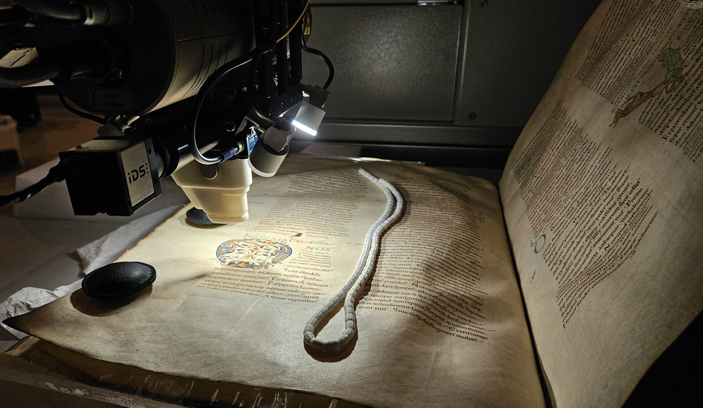
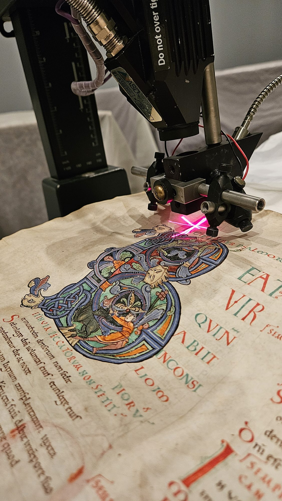
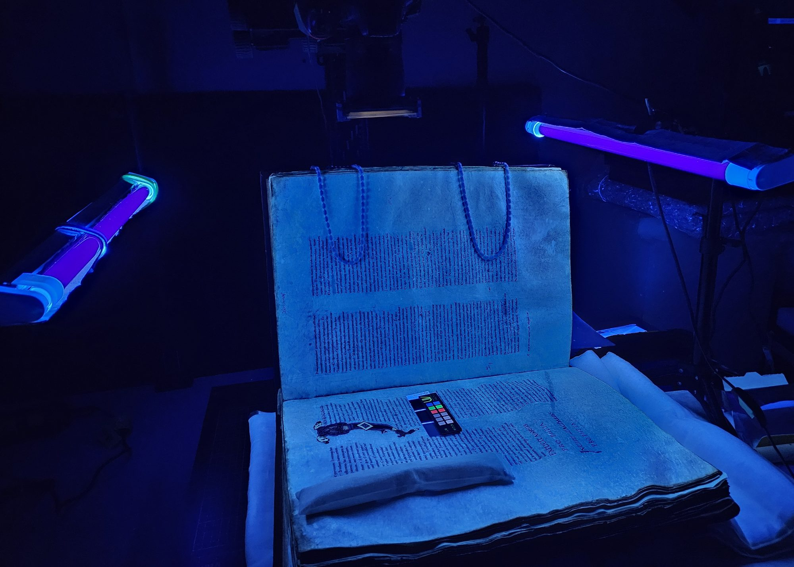
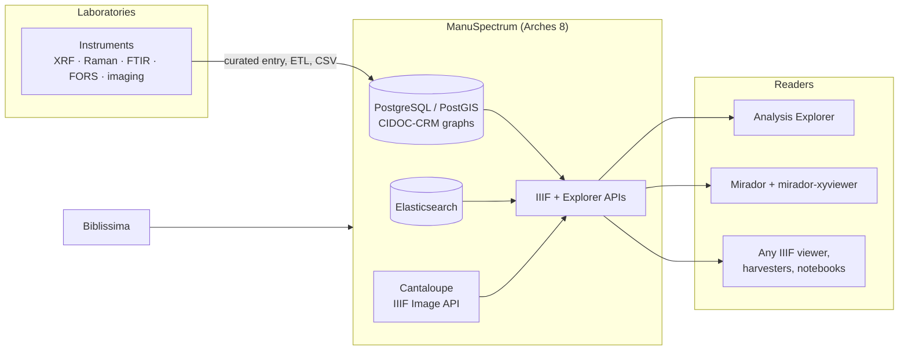

<div align="center">



### Physicochemical analyses of written heritage, open and interoperable

*XRF, Raman, FTIR, FORS and imaging data on manuscripts, printed books and inscriptions,<br>
structured with CIDOC-CRM and published through IIIF.*

[](https://github.com/CRC-Centre-Recherche-Conservation/ManuSpectrum/actions/workflows/main.yml)
[](https://github.com/CRC-Centre-Recherche-Conservation/ManuSpectrum/actions/workflows/deploy-lint.yml)
[](https://github.com/CRC-Centre-Recherche-Conservation/ManuSpectrum/releases)
[](LICENSE)

[](https://www.archesproject.org/)
[](https://www.djangoproject.com/)
[](pyproject.toml)
[](https://vuejs.org/)
[](https://iiif.io/api/presentation/3.0/)
[](https://cidoc-crm.org/)
[](https://projet.biblissima.fr/)

[**Platform**](https://manuspectrum.huma-num.fr/) ·
[**Releases**](https://github.com/CRC-Centre-Recherche-Conservation/ManuSpectrum/releases) ·
[**Deployment**](deploy/README.md) ·
[**Data package**](https://github.com/CRC-Centre-Recherche-Conservation/manuspectrum-pkg) ·
[**Cite**](CITATION.cff)

</div>

---

## Why ManuSpectrum?

Heritage scientists measure manuscripts with many instruments: macro-XRF maps, Raman and FTIR spectra, fibre-optic
reflectance, multispectral and hyperspectral imaging. The results usually stay in lab folders, in formats only their
instrument reads, cut off from the page they describe.

ManuSpectrum brings them together. Every analysis is tied to **the document, the folio and the exact zone** it was
measured on, described with a shared vocabulary, and published as **open IIIF annotations**. Anyone can read them in
the platform's own explorer or in any standard IIIF viewer.

<table>
  <tr>
    <td width="33%"></td>
    <td width="33%"></td>
    <td width="33%"></td>
  </tr>
  <tr>
    <td align="center"><sub><b>Macro-XRF scanning</b><br>elemental maps, without contact</sub></td>
    <td align="center"><sub><b>FORS</b><br>the spectral signature of pigments</sub></td>
    <td align="center"><sub><b>UV hyperspectral imaging</b><br>what the eye cannot see</sub></td>
  </tr>
</table>
<p align="center"><sub>© Centre de Recherche sur la Conservation (CRC), 2025</sub></p>

## ✨ Highlights

| | |
|---|---|
| 🔎 **Analysis Explorer** | A public Vue 3 application at `/{lang}/discover`: filter the corpus by technique, material, colour, place and period, open a document, and build a Selection. |
| 📈 **Compare** | Spectra side by side in resizable windows, with their treatments (normalisation, derivatives…), a linked focus across plots, tables, maps and the folio, a coverage matrix and a periodic table. |
| 🖼️ **Light table** | Every imaging layer of a selection in synchronised panes, a curtain between any two canvases, false-colour stacks of elemental maps. |
| 🌐 **IIIF everywhere** | Presentation 3 and 2.1 manifests and annotations, Content State links to a single zone, IIIF Authorization for restricted files, and `xyReading`, a small IIIF extension that tells a viewer how to plot a spectrum. |
| 📦 **Open exports** | Spectra as clean CSV (never decimated), whole projects as RO-Crate 1.2 packages, citations generated for every product. |
| 🏛️ **Linked to the libraries** | Documents imported from [Biblissima](https://biblissima.fr/) with their identifiers, manifests and illuminations. |
| 🧭 **Shared vocabularies** | Controlled lists published as SKOS in a separate [data package](https://github.com/CRC-Centre-Recherche-Conservation/manuspectrum-pkg) (CC BY), with English and French labels. |
| 🔐 **Careful with data** | Embargoes with automatic lifting, per-field restrictions, two-factor sign-in, accounts created by invitation only, personal data kept to a minimum. |

The interface is fully bilingual (English and French).

## 🧩 How it fits together



Spectra are drawn straight from IIIF annotations by
[**mirador-xyviewer**](https://github.com/CRC-Centre-Recherche-Conservation/mirador-xyviewer), the companion Mirador 4
plugin: the data is never locked inside the platform.

## 🛠️ Built with

- **[Arches 8.1](https://www.archesproject.org/)**: the open-source heritage data platform it extends, with project
  datatypes, functions, widgets, search components and workflows.
- **Django 5.2**, **PostgreSQL / PostGIS**, **Elasticsearch 8**, **Celery** and **Redis**.
- **Vue 3 + TypeScript** for the public applications, **Knockout** where Arches requires it, **Plotly**, **Leaflet**
  and **MapLibre** for plots and maps.
- **Cantaloupe** for IIIF images, **nginx** at the edge.
- Data modelled on **CIDOC-CRM** and **CRMsci**, with controlled lists in **SKOS**.

## 🚀 Getting started (development)

Requirements: Python 3.11 to 3.13, Node.js, PostgreSQL with PostGIS, Elasticsearch 8 and Redis, as for any
[Arches project](https://arches.readthedocs.io/).

```bash
git clone --recurse-submodules https://github.com/CRC-Centre-Recherche-Conservation/ManuSpectrum.git
cd ManuSpectrum

python -m venv ../venv && ../venv/bin/pip install -e .   # or: uv sync
npm install

# Local settings (database, Elasticsearch, Redis) go in manuspectrum/settings_local.py
../venv/bin/python manage.py setup_db
../venv/bin/python manage.py packages -o load_package -s pkg -db -y

npm start                                   # webpack dev server
../venv/bin/python manage.py runserver      # then open http://localhost:8000/
```

Useful checks before a pull request:

```bash
npm run eslint:check && npm run prettier:check && npm run ts:check
../venv/bin/black --check manuspectrum tests
../venv/bin/python manage.py test tests.<module> --settings=tests.test_settings
```

## 🐳 Deployment

Production runs as a Docker Compose stack (web, workers, PostgreSQL, Elasticsearch, Redis, Cantaloupe, nginx, backups
and monitoring), installed on the host by **Ansible**. Releases are **signed `v*` tags**: each image is scanned, signed
and verified before the host installs it, with an automatic rollback if it does not come up healthy.

Start with [`deploy/README.md`](deploy/README.md), then:
[releases](deploy/RELEASES.md) · [backups](deploy/BACKUP.md) · [monitoring](deploy/OBSERVABILITY.md) ·
[administration](deploy/ADMIN.md) · [secrets](deploy/SECRETS.md).

## 🤝 Contributing

Issues and pull requests are welcome. Branches start from `dev` (the integration branch); `main` holds what is
released. CI runs the Python and frontend test suites on Python 3.11 to 3.13, linters, a coverage gate, secret scanning
and, for deployment changes, the whole stack in containers.

## 📚 Cite ManuSpectrum

If you reuse the platform or its data, please cite it (GitHub's **Cite this repository** button reads
[`CITATION.cff`](CITATION.cff)), and credit the laboratory that deposited each record.

> Michelin, A., Kagan, G., Humeau, M. *ManuSpectrum: a platform for the physicochemical analysis of written heritage.*
> Centre de Recherche sur la Conservation (CRC). https://github.com/CRC-Centre-Recherche-Conservation/ManuSpectrum

## 📄 Licence

- **Code**: [GNU AGPL-3.0](LICENSE), like Arches.
- **Data**: each record and file states its own licence; read it before reuse.
- **Data package** (models and vocabularies): CC BY, see [manuspectrum-pkg](https://github.com/CRC-Centre-Recherche-Conservation/manuspectrum-pkg).
- Third-party credits are listed in [`NOTICE`](NOTICE).

## 🙏 Partners and funding

ManuSpectrum is developed at the **Centre de Recherche sur la Conservation** (CRC, UAR 3224: CNRS, Muséum national
d'Histoire naturelle, Ministère de la Culture), with the **IRHT** (CNRS), as a project of the **Biblissima+** Cluster 2,
funded by the French National Research Agency (ANR-21-ESRE-0005). It is hosted by **Huma-Num**.

<p align="center">
  &nbsp;&nbsp;&nbsp;
  &nbsp;&nbsp;&nbsp;
  &nbsp;&nbsp;&nbsp;
  &nbsp;&nbsp;&nbsp;
  &nbsp;&nbsp;&nbsp;
  
</p>
